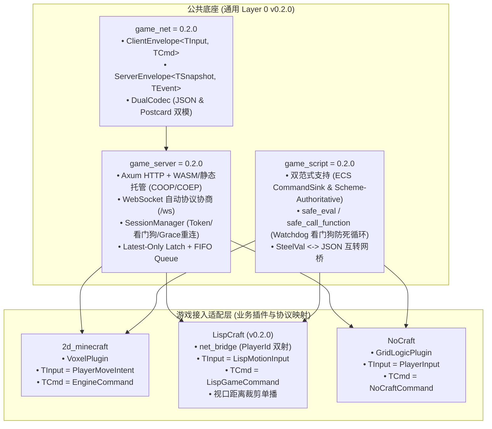

# 跨游戏通用网络底座与移植总览 (Cross-Game Networking Porting Portal)

本文档是跨三款游戏（`2d_minecraft`、`LispCraft`、`NoCraft`）的通用网络底座移植与复用总目录。

目前通用协议、会话网关与脚本插件底座均已升级至 **`v0.2.0`** 并完成工程化验证：
- **`game_net` (`v0.2.0`)**：跨游戏通用协议信封（`ClientEnvelope` / `ServerEnvelope`）、双模自适应编解码（JSON 文本调试 + Postcard 二进制压缩）。
- **`game_server` (`v0.2.0`)**：Axum 单端口 HTTP WASM 托管（COOP/COEP）、WebSocket 自动协议协商、SessionManager 会话看门狗与高频移动 Latest-Only Latch 流水线。
- **`game_script` (`v0.2.0`)**：双范式 Scheme 脚本引擎（既支持 Bevy 风格 `ScriptPlugin` + `CommandSink`，也支持 Scheme-Authoritative 状态机的看门狗安全求值 `safe_eval` 与 `safe_call_function`）。

---

## 1. 针对各游戏专属 Agent 的移植文档

针对各个游戏的负责 Agent，已分别编写了定制化的移植指南：

1. **LispCraft Agent 实战指南**：👉 [`docs/PORTING_TO_LISPCRAFT.md`](file:///workspace/LispCraft/docs/PORTING_TO_LISPCRAFT.md)
   - 网络信封与 `shared/src/lib.rs`（`ClientMsg`, `ClientState`, `EntityDesc`）的映射接入。
   - `PlayerId(u64) <-> "player_{id}"(String)` 双射转换与个性化视口距离裁剪单播（>25m 空间裁剪）。
   - 单端口一体化网关与 19 项端到端多客户端并发自动化测试（100% 通过）。

2. **NoCraft Agent 指南**：👉 `docs/PORTING_TO_NOCRAFT.md`
   - 网络信封与 `engine-protocol`（`PlayerInput`, `ViewportSnapshot`）的映射接入。
   - `ScriptPlugin` 插件改造：将 `crates/engine-logic` 迁移至 `game_script`，直接复用标准的 `SteelVal <-> JSON` 互转与 `safe_eval`。

---

## 2. 核心架构与三底座零侵入复用模型



---

## 3. 两种主流脚本驱动范式在 `game_script` 中的落地

### 范式 A：ECS 插件与无锁事务指令总线 (如 `2d_minecraft`)
适合 Rust ECS 主导世界状态的游戏。Scheme 作为扩展插件，向 `CommandSink` 发射强类型指令：

```rust
pub struct GameLogicPlugin;
impl ScriptPlugin for GameLogicPlugin {
    fn name(&self) -> &'static str { "game_logic" }

    fn build(&self, ctx: &mut PluginContext) -> Result<(), PluginError> {
        let sink = ctx.command_sink.clone();
        ctx.engine.register_fn("spawn-unit!", move |name: String, x: f64, y: f64| {
            sink.emit(SpawnEntityCommand { entity_type: name, x, y });
        });
        Ok(())
    }
}
```

### 范式 B：Scheme 完全主导世界状态机 (如 `LispCraft`)
适合纯动态语言驱动的世界。整个游戏世界实体、物理碰撞、距离裁剪完全由 Scheme 虚拟机承载，Rust 作为安全 Host 通过 100ms 看门狗驱动：

```rust
// 1. 安全求值 (带 100ms 超时看门狗，防终端用户死循环卡死服)
let echo = scheme_app.safe_eval("(heal-player! id)", 100)?;

// 2. 原生函数高效调用与单播视口裁剪
let snapshot = scheme_game.get_client_state(&player_name);
server.send_to(player_id, ServerEnvelope::Snapshot(snapshot));
```
