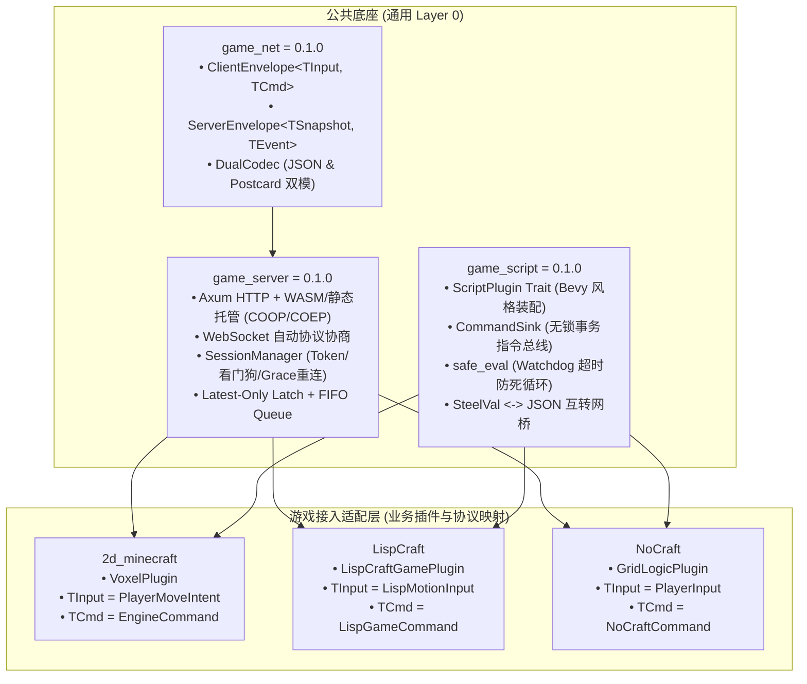

# 跨游戏通用网络底座与移植总览 (Cross-Game Networking Porting Portal)

本文档是跨三款游戏（`2d_minecraft`、`LispCraft`、`NoCraft`）的通用网络底座移植与复用总目录。

目前通用协议、会话网关与脚本插件底座均已实现标准化解耦：
- **`game_net` (`v0.1.0`)**：[crates.io/crates/game_net](https://crates.io/crates/game_net)（跨游戏通用协议信封与双模自适应编解码）
- **`game_server` (`v0.1.0`)**：[crates.io/crates/game_server](https://crates.io/crates/game_server)（Axum HTTP WASM 托管、WebSocket、看门狗会话与输入流水线）
- **`game_script` (`v0.1.0`)**：通用双层插件架构 Scheme 脚本引擎（`ScriptPlugin`、`CommandSink`、Watchdog 超时看门狗与热重载）

---

## 1. 针对各游戏专属 Agent 的移植文档

针对各个游戏的负责 Agent，已分别编写了定制化的移植指南：

1. **LispCraft Agent 指南**：👉 [`docs/PORTING_TO_LISPCRAFT.md`](file:///workspace/2d_minecraft/docs/PORTING_TO_LISPCRAFT.md)
   - 网络信封与 `shared/src/lib.rs`（`ClientMsg`, `ClientState`, `EntityDesc`）的映射接入。
   - `ScriptPlugin` 插件改造：将 `server/src/scheme_game.rs` 改造为标准 `LispCraftPlugin`，统一接入 `CommandSink` 与看门狗保护。

2. **NoCraft Agent 指南**：👉 [`docs/PORTING_TO_NOCRAFT.md`](file:///workspace/2d_minecraft/docs/PORTING_TO_NOCRAFT.md)
   - 网络信封与 `engine-protocol`（`PlayerInput`, `ViewportSnapshot`）的映射接入。
   - `ScriptPlugin` 插件改造：将 `crates/engine-logic` 迁移至 `game_script`，直接复用标准的 `SteelVal <-> JSON` 互转与 `safe_eval`。

---

## 2. 核心架构与三底座零侵入复用模型



---

## 3. 通用插件式脚本引擎 (`game_script`) 接入范式

任何游戏只需编写一个 `ScriptPlugin` 即可安全注入自定义 Scheme 原语，并通过 `CommandSink` 无锁发射指令，游戏循环在每 Tick 统一消费：

```rust
use game_script::{ScriptApp, ScriptPlugin, PluginContext, PluginError, AnyCommand};

// 1. 定义游戏的强类型指令
#[derive(Debug)]
pub struct SpawnEntityCommand { pub entity_type: String, pub x: f64, pub y: f64 }
impl AnyCommand for SpawnEntityCommand {
    fn as_any(&self) -> &dyn std::any::Any { self }
}

// 2. 实现游戏特异业务插件
pub struct GameLogicPlugin;
impl ScriptPlugin for GameLogicPlugin {
    fn name(&self) -> &'static str { "game_logic" }

    fn build(&self, ctx: &mut PluginContext) -> Result<(), PluginError> {
        let sink = ctx.command_sink.clone();
        
        // 向 Scheme VM 注册原生函数，内部发射事务指令，绝不产生锁冲突
        ctx.engine.register_fn("spawn-unit!", move |name: String, x: f64, y: f64| {
            sink.emit(SpawnEntityCommand { entity_type: name, x, y });
        });
        Ok(())
    }
}

// 3. 宿主装配与主循环消费
fn main() -> Result<(), Box<dyn std::error::Error>> {
    let mut app = ScriptApp::new();
    app.add_plugin(GameLogicPlugin)?;
    app.watch_directory("scripts/");

    // 安全求值（带 100ms 超时看门狗，防死循环）
    app.safe_eval("(spawn-unit! \"goblin\" 10.0 20.0)", 100)?;

    // 游戏主循环每 Tick 批量拉取指令
    let commands = app.drain_commands();
    for cmd in commands {
        if let Some(spawn) = cmd.as_any().downcast_ref::<SpawnEntityCommand>() {
            println!("Spawned: {:?}", spawn);
        }
    }
    Ok(())
}
```
