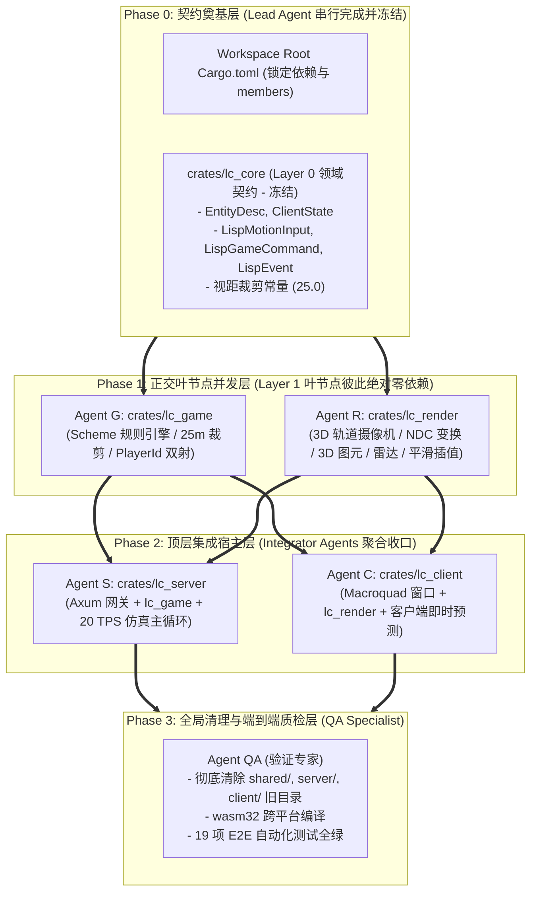

# 分阶段多 AI Agent 协同并发工作手册 (Multi-Agent DAG Workflow)

本文档定义了 **LispCraft 3D** 在多 AI Agent 协同开发场景下的**单向树状无环 (DAG) 依赖拓扑、文件所有权隔离边界、分阶段同步屏障（Synchronization Barriers）以及各 Agent 的接口契约**，确保项目在“全部推倒重来、彻底清除历史遗留代码”的重构过程中，实现**零文件冲突、零循环依赖、各模块可独立编译与单测**。

---

## 1. 三层单向星型树状 DAG 依赖不变量

本项目重构严格遵守 **Strict 3-Tier Star-Tree DAG** 拓扑规范，任何违反依赖层级的调用均在编译期被拦截：

> [!IMPORTANT]
> **核心铁律（DAG 依赖不变量）**：
> 1. `game_net`、`game_script`、`game_server` 来自 crates.io 权威发布，作为公共底座。
> 2. `crates/lc_core` 属于 Layer 0 纯领域契约，仅依赖 `game_net`，绝对不包含任何业务和渲染逻辑。
> 3. `crates/lc_game` 与 `crates/lc_render` 属于 Layer 1，**两者之间互不依赖、互不引用**。
> 4. `crates/lc_server` 与 `crates/lc_client` 属于 Layer 2，作为二进制入口聚合 Layer 1 模块，禁止向底层反向传递代码。

---

## 2. 文件读写所有权隔离矩阵 (File Ownership & Write-Scope Matrix)

每个参与协同的 Agent 被严格限制在专属目录中工作，跨界写入一律禁止，从根源消除 Git/文件合并冲突：

| Agent 角色 | 所属阶段 | 独占写入路径 (Exclusive Write Scope) | 只读参考路径 (Read-Only) | 独立编译验证命令 |
| :--- | :--- | :--- | :--- | :--- |
| **Lead Architect** | Phase 0 | `/Cargo.toml` `crates/lc_core/**` `docs/**` | 全局 | `cargo check -p lc_core` |
| **Agent G** (游戏逻辑专家) | Phase 1 | `crates/lc_game/**` | `crates/lc_core/**` `games/**` | `cargo test -p lc_game` |
| **Agent R** (渲染与数学专家) | Phase 1 | `crates/lc_render/**` | `crates/lc_core/**` | `cargo check -p lc_render` |
| **Agent S** (服务端宿主专家) | Phase 2 | `crates/lc_server/**` | `crates/lc_core/**` `crates/lc_game/**` | `cargo run --bin server games/space_arena.scm` |
| **Agent C** (客户端宿主专家) | Phase 2 | `crates/lc_client/**` | `crates/lc_core/**` `crates/lc_render/**` | `cargo check -p lc_client` |
| **Agent QA** (验证专家) | Phase 3 | 清理历史根目录旧包 `tests/**` | 全局 | `python3 tests/e2e_multiplayer_test.py` |

---

## 3. 分阶段执行屏障 (Synchronization Barriers)

### 阶段 0：契约奠基与 Workspace 统一配置 (Barrier 0)
- **负责角色**：Lead Architect。
- **任务目标**：
  1. 重写工作区根 `Cargo.toml`，引入 `game_net = "0.2.0"`, `game_server = "0.2.0"`, `game_script = "0.2.0"`；
  2. 创建 `crates/lc_core`，规范化定义 `EntityDesc`, `ClientState`, `LispMotionInput`, `LispGameCommand`, `LispEvent`；
  3. 冻结 `lc_core` 接口。

### 阶段 1：叶节点并发实现 (Barrier 1)
- **负责角色**：Agent G 与 Agent R 并行执行。
- **任务目标**：
  - **Agent G**：在 `crates/lc_game` 中实现 `ScriptPlugin`，挂载 Scheme 世界，封装 25m 视距裁剪与 `PlayerId` 双射，移植单测确保 `cargo test -p lc_game` 毫秒级全过。
  - **Agent R**：在 `crates/lc_render` 中封装 3D 轨道摄像机、NDC 投影、3D 图元网格管线、2D 雷达小地图与 60 FPS 远端平滑插值缓冲区。

### 阶段 2：宿主聚合装配 (Barrier 2)
- **负责角色**：Agent S 与 Agent C 并行执行。
- **任务目标**：
  - **Agent S**：在 `crates/lc_server` 中装配 `game_server::start_server` 与 `lc_game`，配置 `[[bin]] name = "server"`，驱动 20 TPS 仿真主循环。
  - **Agent C**：在 `crates/lc_client` 中配置 `[[bin]] name = "client"`，装配 Macroquad 窗口、`lc_render` 渲染管线、客户端即时预测器与 Scheme REPL 控制台。

### 阶段 3：历史代码推倒与全量质检验收 (Barrier 3)
- **负责角色**：Agent QA。
- **任务目标**：
  1. 彻底删除顶层遗留的 `shared/`、`server/`、`client/` 目录，无任何历史包袱；
  2. 验证 WASM 编译：`cargo build --release --target wasm32-unknown-unknown --bin client`；
  3. 运行跨进程集成测试：`python3 tests/e2e_multiplayer_test.py`，确保 19/19 验收用例全绿通过！
