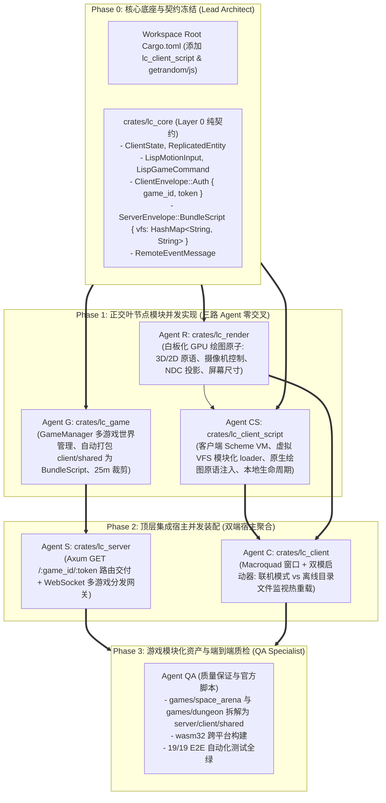

# 分阶段多 AI Agent 协同并发工作手册 (Roblox 平台化架构版)

本文档定义了 **LispCraft 3D** 构建 **白板化 GPU 绘图宿主 + 双端模块化 Scheme + 服务端多游戏动态挂载 + 浏览器优先 URL 路由 + 本地离线热更新开发模式** 下的**单向树状无环 (DAG) 依赖拓扑、文件所有权隔离边界、分阶段同步屏障以及各 Agent 接口契约**。

---

## 1. 严格 3-Tier Star-Tree DAG 依赖不变量

本项目重构严禁任何跨层级或反向依赖：

---

## 2. 文件读写所有权隔离矩阵 (File Ownership Matrix)

每个 AI Agent 被严格限定在专属路径中写入代码，禁止跨界修改，确保并发零冲突：

| Agent 角色 | 所属阶段 | 独占写入路径 (Exclusive Write Scope) | 只读依赖路径 (Read-Only) | 独立编译验证命令 |
| :--- | :--- | :--- | :--- | :--- |
| **Lead Architect** | Phase 0 | `/Cargo.toml` `crates/lc_core/**` `docs/**` | 全局 | `cargo check -p lc_core` |
| **Agent R** (渲染原子专家) | Phase 1 | `crates/lc_render/**` | `crates/lc_core/**` | `cargo test -p lc_render` |
| **Agent CS** (客户端脚本专家) | Phase 1 | `crates/lc_client_script/**` | `crates/lc_core/**` `crates/lc_render/**` | `cargo test -p lc_client_script` |
| **Agent G** (服务端游戏引擎专家) | Phase 1 | `crates/lc_game/**` | `crates/lc_core/**` | `cargo test -p lc_game` |
| **Agent S** (服务端宿主专家) | Phase 2 | `crates/lc_server/**` | `crates/lc_core/**` `crates/lc_game/**` | `cargo check -p lc_server` |
| **Agent C** (客户端双模宿主专家) | Phase 2 | `crates/lc_client/**` | `crates/lc_core/**` `crates/lc_client_script/**` `crates/lc_render/**` | `cargo check --target wasm32-unknown-unknown -p lc_client` |
| **Agent QA** (资产与验证专家) | Phase 3 | `games/**` `web/**` `tests/**` | 全局 | `python3 tests/e2e_multiplayer_test.py` |

---

## 3. 分阶段执行屏障 (Synchronization Barriers)

### 阶段 0：契约奠基与根配置 (Barrier 0)
- **负责角色**：Lead Architect。
- **任务目标**：
  1. 根 `Cargo.toml` 注册 `crates/lc_client_script` 为 workspace 成员，配置 wasm32 下 `getrandom = { version = "0.2.17", features = ["js"] }`；
  2. `crates/lc_core` 升级协议信封：
     - `ClientEnvelope::Auth { game_id: String, token: String, client_version: String }`
     - `ServerEnvelope::BundleScript { game_id: String, vfs: HashMap<String, String> }`
     - `RemoteEventMessage { event_name: String, payload: serde_json::Value }`
  3. 冻结 `lc_core` 接口。

### 阶段 1：叶节点正交并发实现 (Barrier 1)
- **负责角色**：Agent R、Agent CS、Agent G 三方并发。
- **任务目标**：
  - **Agent R**：剔除所有机甲等业务硬编码，重构为白板化 3D/2D GPU 绘图原子库（`draw_cube`, `draw_sphere`, `draw_plane`, `draw_cylinder`, `draw_text_screen`, `draw_rect`, `draw_circle`, `OrbitCamera`, `world_to_screen`）；
  - **Agent CS**：构建 `crates/lc_client_script`，内嵌 Steel Scheme VM（WASM 兼容），实现内存虚拟文件系统（VFS）loader，注入原生绘图原子 API，支持 `(client-init)`、`(client-render dt)`、`(fire-server!)`；
  - **Agent G**：在 `crates/lc_game` 中实现 `GameManager`，支持动态扫描并加载 `games/<game_id>`，将该游戏的 `client/` 和 `shared/` 打包为 `BundleScript`，运行多世界独立 Scheme 虚拟机。

### 阶段 2：顶层集成宿主并发装配 (Barrier 2)
- **负责角色**：Agent S 与 Agent C 并发。
- **任务目标**：
  - **Agent S**：在 `crates/lc_server` 中实现动态 Axum 路由（`GET /:game_id/:token` 响应注入上下文的 HTML），并在 WebSocket `/ws` 握手时根据 `game_id` 绑定至对应游戏实例；
  - **Agent C**：在 `crates/lc_client` 中实现双模启动：
    - 联机模式：支持 `client http://ip:port/:game_id/:token`，行为与浏览器完全一致；
    - 离线开发模式：支持 `client games/space_arena/client`，直接执行本地脚本并启动后台线程监听 `.scm` 文件变更，实现即时热更新（Hot-Reload）。

### 阶段 3：模块化规则包重构与全绿验收 (Barrier 3)
- **负责角色**：Agent QA。
- **任务目标**：
  1. 重构 `games/` 目录：
     - `games/space_arena/{server, client, shared}`
     - `games/dungeon/{server, client, shared}`
     - 将原客户端写死的机甲外观、雷达小地图、HUD 仪表盘全部用客户端 Scheme 重写；
  2. 验证 WebAssembly 编译产出 `web/client.wasm`；
  3. 运行端到端集成测试 `python3 tests/e2e_multiplayer_test.py`，确保 19/19 验收用例 100% 全绿通过！
