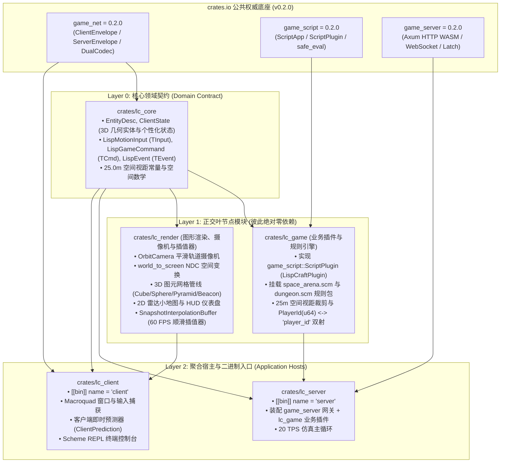

# LispCraft 重构需求规格与 DAG 架构定义书 (Requirements & Architectural Specification)

本文档定义了 **LispCraft 3D** 项目彻底推倒历史遗留架构、对标 `/workspace/2d_minecraft` 的规范化 **三层单向星型树状无环 (Strict 3-Tier Star-Tree DAG)** Cargo Workspace 架构重构规范。

---

## 1. 重构背景与愿景

### 1.1 历史遗留痛点
1. **客户端巨石混杂**：原 `client/src/main.rs` 膨胀至 1350 行，网络、摄像机、投影数学、雷达、3D 渲染、Scheme 终端 REPL 全塞在一个文件中。
2. **顶层目录结构扁平混乱**：`shared`、`server`、`client` 平铺在根目录，未组织进 `crates/`。
3. **依赖声明割裂**：根 `Cargo.toml` 未启用 `[workspace.dependencies]` 集中版本控制。
4. **网络体验缺乏现代化标准**：缺少客户端预测与远端实体平滑插值，网络存在粘滞感。

### 1.2 核心愿景
彻底推倒遗留代码结构，**零历史包袱**重构：
- **公共三底座标准化**：直接引入 crates.io 权威发布的 `game_net = "0.2.0"`, `game_server = "0.2.0"`, `game_script = "0.2.0"`。
- **纯正交 DAG 架构**：各 Crate 职责单一，单向依赖无环，支持多 Agent 并发开发。
- **Roblox 级别网络体验**：双端解耦渲染，客户端零延迟即时预测，远端实体 60/144 FPS 顺滑插值。
- **100% 验收无损**：二进制名称保持 `server` 与 `client`，保证 WASM 编译与 19 项 E2E 自动化测试全绿。

---

## 2. 外部权威底座引入 (Crates.io 正式版)

在工作区根 `Cargo.toml` 中，直接使用已发布至 crates.io 的工业级三底座，彻底杜绝自研轮子：

```toml
[workspace.dependencies]
# 1. 协议标准 (DualCodec 自适应编解码 + 通用双泛型信封)
game_net = "0.2.0"

# 2. 基础设施网关 (Axum HTTP WASM 单端口托管 + WebSocket 会话看门狗 + Latest-Only Latch)
game_server = "0.2.0"

# 3. 脚本插件大脑 (Steel Scheme VM 包装 + ScriptPlugin 插件规范 + 100ms safe_eval 看门狗)
game_script = "0.2.0"
```

---

## 3. 架构拓扑与 Crates 职责定义

重构后工作区包含 5 个正交领域 Crate：



### 3.1 模块职责边界明细表

| Crate 路径 | 所属层级 | 核心职责 | 依赖限制 (反向依赖一律编译报错) |
| :--- | :--- | :--- | :--- |
| `crates/lc_core` | **Layer 0** | 纯数据结构、协议 DTO 与视距常量，零业务逻辑 | 仅依赖 `game_net`, `serde`, `serde_json` |
| `crates/lc_game` | **Layer 1** | 实现 `ScriptPlugin`，封装 Scheme 虚拟机交互、25m 视距单播状态生成与 PlayerId 双向映射 | 仅单向依赖 `lc_core`, `game_script`, `game_net` |
| `crates/lc_render` | **Layer 1** | 3D 摄像机、NDC 投影、3D 图元渲染、2D 雷达小地图与远端实体平滑插值缓冲区 | 仅单向依赖 `lc_core`, `macroquad` |
| `crates/lc_server` | **Layer 2** | 服务端二进制 (`bin: server`)，调用 `game_server::start_server`，驱动 20 TPS 物理与逻辑循环 | 依赖 `lc_core`, `lc_game`, `game_server`, `tokio` |
| `crates/lc_client` | **Layer 2** | 客户端二进制 (`bin: client`)，Macroquad 窗口主循环，驱动客户端预测、REPL 终端交互与画面绘制 | 依赖 `lc_core`, `lc_render`, `game_net`, `macroquad`, `quad-net` |

---

## 4. Roblox 风格双端解耦渲染与状态同步规范

### 4.1 客户端即时移动预测 (Client-side Prediction)
- **原理**：玩家在本地按下 `W/A/S/D` 瞬间，本地角色坐标立即沿速度矢量自驱更新，并实时将 `LispMotionInput { dx, dz, yaw }` 经由 `game_net` 发往服务端。
- **软纠偏 (Soft Reconciliation)**：
  - 客户端持续接收服务端 20 TPS 下发的权威 `ClientState.camera_target`。
  - 计算本地推导位置与服务端权威位置的漂移差向量 $\vec{E} = \vec{P}_{server} - \vec{P}_{local}$：
    - 若 $|\vec{E}| < 5.0\text{m}$：本地位置平滑混合 $\vec{P}_{local} \leftarrow \vec{P}_{local} + \vec{E} \times 0.2$（毫秒级抹平微小网络抖动）；
    - 若 $|\vec{E}| \ge 5.0\text{m}$（如碰撞阻挡、传送、击退）：强制对齐权威位置 $\vec{P}_{local} \leftarrow \vec{P}_{server}$。

### 4.2 远端实体 60/144 FPS 顺滑插值 (Snapshot Interpolation)
- **原理**：服务端以 20 TPS (50ms) 下发快照，客户端以 60~144 FPS 渲染。
- **插值器设计**：`lc_render` 维护双快照时间戳缓冲区 $(T_0, S_0)$ 与 $(T_1, S_1)$。
- 在当前渲染时间点 $T_{render} = T_{now} - 50\text{ms}$，对除本地主角外的全部远端实体坐标执行线性插值：
  $$\vec{P}_{interpolated} = \text{Lerp}(\vec{P}_0, \vec{P}_1, \frac{T_{render} - T_0}{T_1 - T_0})$$
- 彻底消除远端角色和移动图元的 20 TPS 抽搐感，肉眼所见即为 60+ FPS 顺滑物理移动。

---

## 5. 验收标准与测试矩阵 (Zero-Regression Guarantee)

重构后必须满足以下全部硬性指标：
1. **代码健康度**：全工作区 `cargo check --workspace` 与 `cargo clippy --workspace` 零 Warning。
2. **单测无缝通过**：`crates/lc_game` 独立单测 `cargo test -p lc_game` 100% 毫秒级通过（覆盖 `space_arena.scm` 与 `dungeon.scm` 的完整生命周期、25m 裁剪与拾取机制）。
3. **WASM 编译兼容**：执行 `cargo build --release --target wasm32-unknown-unknown --bin client` 正常产出 `web/client.wasm`。
4. **E2E 跨进程黑盒测试**：执行 `python3 tests/e2e_multiplayer_test.py`，全部 19 项场景用例（HTTP 托管、WebSocket 自动协商、多玩家视距单播裁剪、聊天广播、REPL 安全求值）100% 通过！
