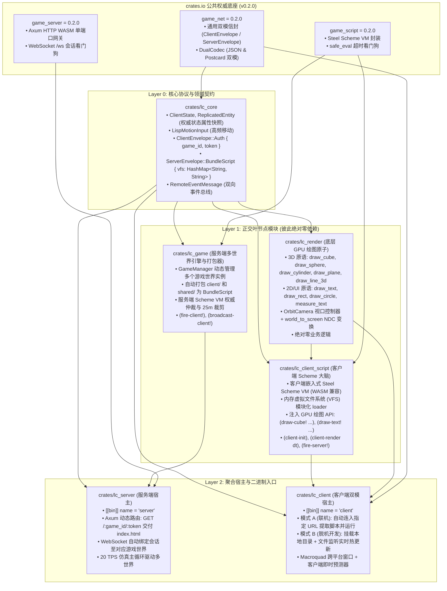

# LispCraft 分布式 Scheme 游戏引擎架构规格书 (Roblox Architecture Specification)

本文档定义了 **LispCraft 3D** 全新平台化架构：**白板化 GPU 绘图宿主 + 双端模块化 Scheme + 服务端多游戏动态挂载 + 浏览器优先 URL 路由 + 本地离线热更新开发模式** 的权威设计规范与工程契约。

---

## 1. 核心架构设计原则

### 1.1 客户端 3D 白板化 (Whiteboard GPU Host)
- **彻底清除 Rust 业务硬编码**：Rust 代码中不得包含任何机甲模型、特定方块类型、地表网格参数、雷达造型或特定 HUD 排版；
- **纯粹的 GPU 原语宿主**：Rust 仅负责提供高性能的 Macroquad 3D/2D 绘图原子、摄像机视口控制与输入捕获；
- **100% 表现层由 Scheme 决定**：场景生成、角色外观、粒子流光、血条样式、文字广告牌完全由客户端 Scheme 脚本实时计算并调用原子 API 现场绘制。

### 1.2 资源集中托管与模块化分包 (Modular VFS Bundling)
- 游戏资产全部由服务端集中存放与版本管理；
- 项目目录规范：每个游戏独立子目录，划分为 `server/`、`client/`、`shared/`；
- 双端支持模块化加载，服务端将客户端脚本及其依赖打包为内存虚拟文件系统（Virtual VFS）在连接建立时自动下发。

### 1.3 浏览器优先与单服务多游戏动态挂载 (Multi-Game Dynamic Routing)
- 服务端动态扫描 `games/` 目录，自动为每个子目录挂载独立的 Scheme 世界实例；
- 浏览器打开 `http://ip:port/:game_id/:token`（例如 `http://localhost:8082/space_arena/guest_1`）即可直接加载进入对应游戏世界；
- WebSocket 自动协商与路由绑定，实现单端口多游戏并发隔离运行。

### 1.4 本地客户端同构体验与离线热更新调试 (Parity & Standalone Hot-Reload)
- **联机模式**：启动命令 `client http://ip:port/:game_id/:token`，与浏览器 WASM 行为 100% 同构；
- **离线开发模式**：脱机执行 `client games/space_arena/client`，直接运行本地客户端脚本并启动文件监视器（File Watcher）。在编辑器中保存 `.scm` 文件后，下一帧自动重新求值并即时渲染，无需重启程序。

---

## 2. 游戏资源目录标准规范 (`games/<game_id>/`)

```text
games/
├── space_arena/                    # 游戏 1: 太空竞技场
│   ├── config.json                 # 游戏元数据 (名称, 视距 25.0, 描述)
│   ├── server/                     # 服务端独占规则脚本 (ServerScript)
│   │   ├── main.scm                # 服务端主入口 (on-init, on-join, on-tick, on-command)
│   │   └── combat.scm              # 战斗仲裁、道具拾取与碰撞判定
│   ├── client/                     # 客户端独占脚本 (LocalScript)
│   │   ├── main.scm                # 客户端主入口 (client-init, client-render)
│   │   ├── hud.scm                 # 赛博 HUD、血条与准星绘制
│   │   ├── radar.scm               # 2D 战术雷达小地图绘制
│   │   └── avatar.scm              # 玩家机甲外观与实体渲染逻辑
│   └── shared/                     # 双端共享定义 (SharedScript)
│       └── constants.scm           # 常量定义、颜色表与事件名契约
└── dungeon/                        # 游戏 2: 暗黑地牢
    ├── config.json
    ├── server/
    │   └── main.scm
    ├── client/
    │   ├── main.scm
    │   ├── hud.scm
    │   └── scene.scm               # 地牢石柱、火把与地表绘制
    └── shared/
        └── constants.scm
```

---

## 3. 严格 3-Tier Star-Tree DAG 架构拓扑



---

## 4. 客户端 Scheme 暴露接口规格 (Whiteboard Host API)

### 4.1 3D 世界图元绘制原语
- `(draw-cube! [x y z] [w h d] [r g b a])`：绘制 3D 立方体；
- `(draw-cube-wires! [x y z] [w h d] [r g b a])`：绘制 3D 线框立方体；
- `(draw-sphere! [x y z] radius [r g b a])`：绘制 3D 实体球；
- `(draw-sphere-wires! [x y z] radius [r g b a])`：绘制 3D 线框球；
- `(draw-cylinder! [x y z] r-top r-bot height sides [r g b a])`：绘制 3D 圆柱/多棱锥；
- `(draw-plane! [x y z] [w d] [r g b a])`：绘制水平 3D 平面；
- `(draw-line-3d! [x1 y1 z1] [x2 y2 z2] [r g b a])`：绘制 3D 空间线段；
- `(draw-billboard-text! text [x y z] font-size [r g b a])`：在 3D 空间坐标上方绘制始终朝向摄像机的 2D 文字。

### 4.2 2D HUD 与 UI 绘制原语
- `(draw-text-screen! text x y font-size [r g b a])`：在屏幕指定像素位置绘制 2D 文本；
- `(draw-rect! x y w h [r g b a])`：绘制 2D 矩形（用于底板、血条槽）；
- `(draw-rect-lines! x y w h thickness [r g b a])`：绘制 2D 矩形边框；
- `(draw-circle! x y radius [r g b a])`：绘制 2D 圆形（用于雷达背景、准星）；
- `(draw-circle-lines! x y radius thickness [r g b a])`：绘制 2D 圆环；
- `(draw-line-2d! x1 y1 x2 y2 thickness [r g b a])`：绘制 2D 屏幕线段；
- `(measure-text-width text font-size)`：测量文本屏幕渲染宽度。

### 4.3 视口、输入与状态查询
- `(set-camera! [target-x target-y target-z] yaw pitch distance)`：设置 3D 轨道摄像机目标与视角；
- `(get-camera-params)`：获取当前摄像机的观察点与方向向量；
- `(world-to-screen [x y z])`：将 3D 空间点投影为屏幕 `[sx sy]`，超出视野返回 `#f`；
- `(screen-width)` / `(screen-height)`：获取当前屏幕尺寸；
- `(is-key-down? key-str)`：检测按键是否处于按下状态（如 `"W"`, `"A"`, `"Space"`）；
- `(is-key-pressed? key-str)`：检测按键是否在当前帧被按下；
- `(get-mouse-pos)` / `(get-mouse-wheel)`：获取鼠标坐标与滚轮位移；
- `(get-replicated-entities)`：获取服务端属性复制下来的视距内实体列表；
- `(get-local-player)`：获取本地主角当前权威状态（坐标、血量、得分）；
- `(fire-server! event-name payload-json)`：向服务端触发 RemoteEvent。

---

## 5. 跨端通信与动态路由工作流

### 5.1 浏览器端动态路由生命周期
1. 用户访问 `http://ip:port/:game_id/:token`（如 `/space_arena/guest_1`）；
2. Axum 网关响应 `index.html`，HTML 脚本提取当前 `pathname` 中的 `game_id` 与 `token`；
3. 浏览器实例化 `client.wasm`，自动连入 `ws://ip:port/ws`；
4. 客户端首包发送 `ClientEnvelope::Auth { game_id: "space_arena", token: "guest_1", client_version: "0.2.0" }`；
5. 服务端定位到 `games/space_arena/`，打包该游戏的 `client/` 和 `shared/` 脚本为 `BundleScript` 下发；
6. 客户端 Scheme VM 将 VFS 加载并执行 `client/main.scm`，启动本地游戏循环！

### 5.2 本地离线开发模式生命周期 (Standalone Hot-Reload)
1. 开发者在终端执行：
   ```bash
   cargo run --bin client games/space_arena/client
   ```
2. 客户端识别路径为本地有效目录，进入 **离线开发模式**（无需启动 server）；
3. 客户端直接读取本地 `main.scm` 并启动后台线程监听该目录下所有 `.scm` 文件的修改时间；
4. 开发者在编辑器中修改并保存代码后，控制台触发：
   ```text
   [HotReload] Detected modification in 'avatar.scm'. Reloading client scripts...
   [HotReload] Successfully hot-reloaded in 1.2ms.
   ```
5. 屏幕画面下一帧立即发生改变，无需重启进程，实现毫秒级迭代！

---

## 6. 验收标准与质量保障

1. **白板化验证**：`lc_render` 和 `lc_client` 源码中绝不包含任何特定游戏实体、外观造型或特定 HUD 的硬编码；
2. **多游戏动态加载**：单服务端实例可同时服务 `/space_arena` 与 `/dungeon`；
3. **双模运行测试**：
   - 联机模式通过 `tests/e2e_multiplayer_test.py` 全部 19 项测试；
   - 离线模式可通过本地命令直接启动并渲染；
4. **WASM 编译与发布**：
   - `cargo build --release --target wasm32-unknown-unknown --bin client` 顺利编译产出 `web/client.wasm`。
